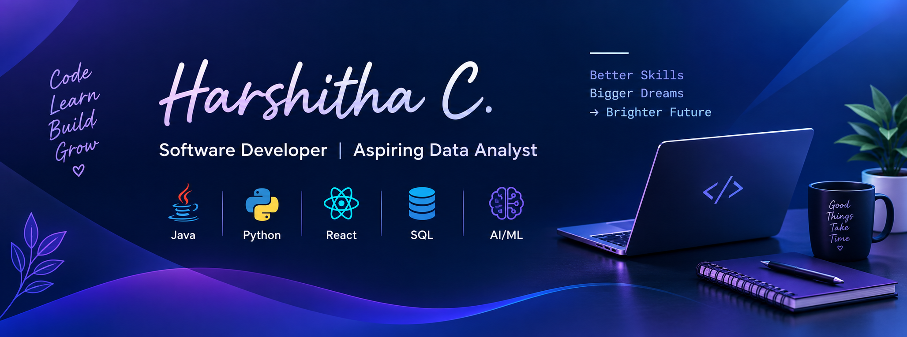

 

  

# Hi 👋, I'm Harshitha C.

### Software Developer | Java • Spring Boot • React • REST APIs • MySQL

I develop practical web applications and backend services using Java, Spring Boot, React, and SQL. I enjoy integrating APIs, solving development issues, and contributing to open-source projects.

  
  
  

---

## 👩‍💻 About Me

- 💻 Interested in backend and full-stack software development.
- ☕ Working with Java, Spring Boot, React, and REST APIs.
- 🗄️ Building applications with MySQL, MongoDB, and H2.
- 🔐 Exploring authentication, authorization, and OAuth 2.0 integrations.
- 🛠️ Using Git, GitHub, Maven, Docker, and Postman.
- 🌍 Contributing to open-source projects and improving my software engineering skills.
- 📊 Also interested in SQL, Python, and data analytics.

---

## 🛠️ Technical Skills

**Languages**

`Java` `JavaScript` `SQL` `Python`

**Backend & APIs**

`Spring Boot` `Spring MVC` `Spring Security` `JDBC` `FastAPI` `REST APIs`

**Frontend**

`React` `HTML` `CSS` `Bootstrap`

**Databases**

`MySQL` `MongoDB` `H2`

**Tools & Platforms**

`Git` `GitHub` `Maven` `Docker` `Postman` `VS Code` `Eclipse` `MySQL Workbench`

**Additional Interests**

`Data Analysis` `Excel` `Power BI` `AI/ML` `Generative AI` `TypeScript` `Cloud Technologies`

---

## 💼 Experience

### Freelance Full Stack Developer

**Pre-Startup Client · Remote · 2025**

- Developed approximately 70% of an e-commerce web application using Java, Spring Boot, React, REST APIs, and MySQL.
- Worked on product catalog, shopping cart, checkout, user accounts, and order management features.
- Implemented Admin and Customer roles with role-based access control.
- Collaborated directly with the client on requirements, API integration, debugging, and assigned project scope.

**Technologies:** Java, Spring Boot, React, REST APIs, MySQL

### Software Developer Intern

**Sigvitas & Company · Mysore · October 2024 – December 2024**

- Contributed to a Patent Search and Clustering application.
- Supported frontend-backend integration across application modules.
- Worked with REST APIs and assisted with integration debugging.
- Fixed cross-browser UI issues and supported application troubleshooting.

**Technologies:** Java, Spring Boot, React, REST APIs

---

## 🚀 Featured Projects

### ⭐ StaffHub — Employee Management System

A full-stack employee management application with role-based workflows for Admin, HR, and Employees.

**Tech Stack:** Java 17, Spring Boot, Spring Security, Spring Data JPA, H2, JavaScript

**Key Features**
- Separate Admin, HR, and Employee dashboards
- Employee and department management
- Attendance and leave management
- Task management
- Payroll and payslip features
- Announcements and role-based access control

🔗 **[Live Demo](https://staffhub-employee-management.onrender.com)** · **[Source Code](https://github.com/Harshitha0501/staffhub-employee-management)**

---

### 🔗 Salesforce CRUD Application

A full-stack Salesforce integration application for managing CRM records through API integration.

**Tech Stack:** React, FastAPI, Salesforce API, OAuth 2.0

**Key Features**
- Salesforce OAuth 2.0 authentication
- Create, read, update, and delete operations
- Account, Lead, Opportunity, Contact, and Case management
- Pagination and form validation

🔗 **[Source Code](https://github.com/Harshitha0501/sf-crud-app)**

---

### 🧠 SkillGap AI

A career-focused application that compares skills against selected job roles and provides a personalized learning roadmap.

**Tech Stack:** React, FastAPI, MongoDB, JavaScript

**Key Features**
- Job-role matching and skill-gap identification
- Personalized learning roadmap
- Interview preparation
- Progress tracking
- Rule-based skill scoring

🔗 **[Live Demo](https://skillgap-ai-mu.vercel.app/)** · **[Source Code](https://github.com/Harshitha0501/skillgap-ai)**

---

### ⚙️ URL Shortener

A backend-focused application for creating shortened URLs through REST APIs.

**Tech Stack:** Java, Spring Boot, MySQL, Docker

**Key Features**
- URL shortening
- REST API development
- MySQL database integration
- Dockerized application setup

🔗 **[Source Code](https://github.com/Harshitha0501/url-shortener)**

---

### 📊 Swiggy Restaurant Data Analysis

Analyzed **81,777 restaurant records** to explore restaurant locations, cuisine categories, ratings, pricing patterns, and cost-versus-rating relationships.

**Tech Stack:** MySQL, SQL, Data Cleaning, Data Analysis

🔗 **[Source Code](https://github.com/Harshitha0501/Swiggy-SQL-Analysis)**

---

## 🌍 Open-Source Contributions

I contribute to open-source projects through feature development, user interface improvements, and code refactoring.

### ✅ Developer Portfolios

Added my developer portfolio to the open-source community portfolio collection.

🔗 [Pull Request #4308 — Add Harshitha C. Portfolio](https://github.com/emmabostian/developer-portfolios/pull/4308) · **Merged**

### ✅ SlopTotal Extension

Added a confidence label to quick-score popup results, with subtle styling for the confidence indicator.

🔗 [Pull Request #4 — Add Confidence Label](https://github.com/pablocaeg/sloptotal-extension/pull/4) · **Merged**

### 🔧 Kestra

Contributed a UI refactor to the TimeSelect component by replacing spacing utility classes with dedicated CSS classes.

🔗 [Pull Request #20621 — TimeSelect Spacing Refactor](https://github.com/kestra-io/kestra/pull/20621)

### 🚀 Expense Tracker

Working on dashboard UI/UX improvements to make the interface more responsive, consistent, and user-friendly.

🔗 [Expense Tracker Repository](https://github.com/Harshitha0501/ExpenseTracker)

---

## 📜 Certifications

- [HackerRank — Software Engineer Certificate](https://www.hackerrank.com/certificates/iframe/9a6b4d2791a5)
- [HackerRank — SQL Intermediate Certificate](https://www.hackerrank.com/certificates/iframe/1cbdb84dd236)

---

## 🧰 Languages & Tools

  

  
  

---

## 📈 GitHub Activity

  

Explore my repositories to see my software projects, development work, and open-source contributions.

---

## 🤝 Connect With Me

- 🌐 **Portfolio:** [harshitha-portfolio-fawn.vercel.app](https://harshitha-portfolio-fawn.vercel.app/)
- 💼 **LinkedIn:** [harshitha-c2605](https://linkedin.com/in/harshitha-c2605)
- 🐙 **GitHub:** [Harshitha0501](https://github.com/Harshitha0501)
- 📧 **Email:** [harshithac0512@gmail.com](mailto:harshithac0512@gmail.com)

---

### 🚀 Build • Learn • Contribute • Improve
